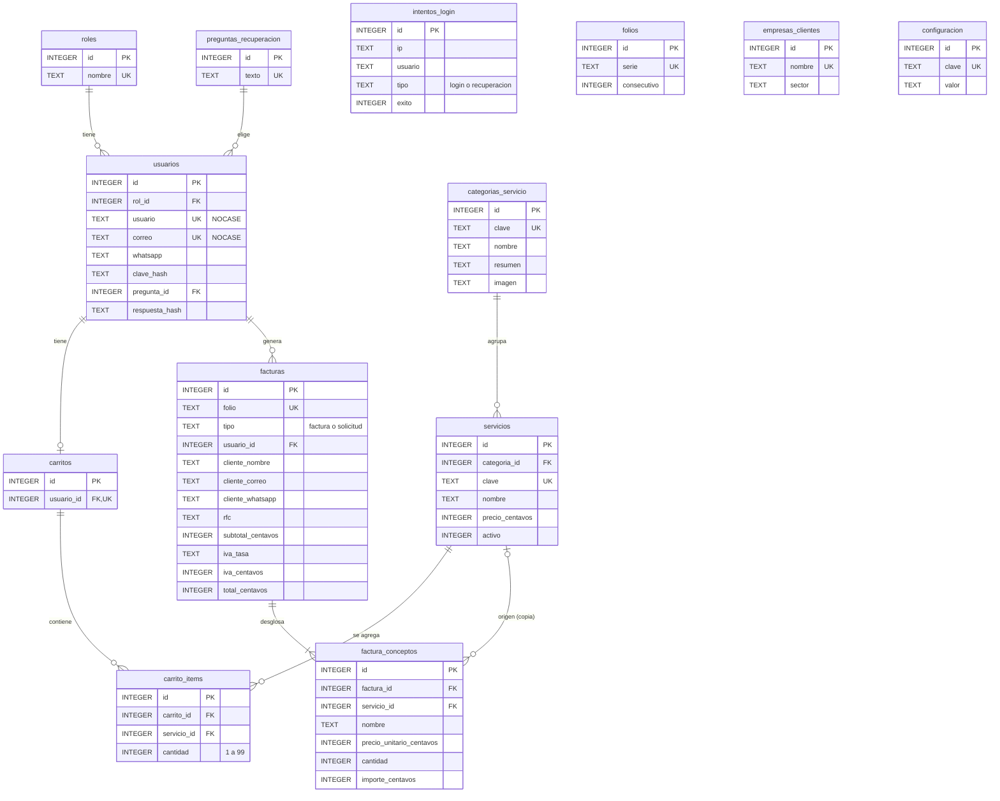

<!-- Documentación de la base de Meridian TI en SQLite: diagrama ER, tablas, tipos y cómo recrearla con esquema.sql y semillas.sql. -->
# Base de datos (SQLite)

La base es **un solo archivo**: `db/meridian.db`. Usa **SQLite**, que viene incluido en Python (módulo `sqlite3`), así que no hay servidor que instalar, ni usuario, ni contraseña, ni puerto.

- `db/esquema.sql`: **solo estructura**, en dialecto SQLite (`CREATE TABLE IF NOT EXISTS`, `CREATE INDEX IF NOT EXISTS`).
- `db/semillas.sql`: **solo catálogo inicial**: roles, preguntas de recuperación, 4 categorías, 16 subservicios con precio, empresas ficticias de Monterrey, emisor, IVA 16 % de referencia y serie de folios. Es idempotente (`INSERT OR IGNORE`): no duplica ni pisa datos, y no reinicia el folio.
- `db/meridian.db`: **se crea sola la primera vez** que arranca el servidor (`backend/db.py`, función `inicializar`). Se aplican el esquema y las semillas en un archivo temporal y, si todo sale bien, se renombra; así nunca queda una base a medias. Si el archivo ya existe, no se toca.

**Los datos reales nunca entran al repositorio.** `.gitignore` excluye `db/meridian.db` (y sus archivos `-wal` y `-shm`). En el repo solo viven `esquema.sql` y `semillas.sql`.

## Reglas de la conexión (`backend/db.py`)

- **Llaves foráneas activas:** cada conexión ejecuta `PRAGMA foreign_keys = ON` (SQLite las trae apagadas por defecto).
- **Consultas parametrizadas** con `?`; nunca se concatena SQL con datos del usuario.
- **Transacciones explícitas:** cada petición abre `BEGIN` (lectura) o `BEGIN IMMEDIATE` (escritura) y termina en `COMMIT` o `ROLLBACK`.
- **Folios consecutivos sin duplicados:** la factura se crea dentro de `BEGIN IMMEDIATE`, que toma el candado de escritura desde el inicio. Dos facturas simultáneas se forman en fila; la segunda espera (hasta 10 s, `busy_timeout`) y lee el folio ya incrementado.
- **Modo WAL** (`journal_mode = WAL`): las lecturas no esperan a las escrituras. Crea junto a la base los archivos temporales `meridian.db-wal` y `meridian.db-shm`.

## Tipos

| Dato | Tipo en SQLite | Ejemplo |
|---|---|---|
| Dinero (precios, subtotal, IVA, total, importes) | `INTEGER` en **centavos**, con `CHECK (typeof(...) = 'integer')` | `200000` = $2,000.00 |
| Tasa de IVA guardada en la factura | `TEXT` con el decimal exacto | `'0.16'` |
| Fechas (`creado_en`) | `TEXT` en hora local | `'2026-11-11 16:30:00'` |
| Booleanos (`activo`, `exito`) | `INTEGER` 0/1 con `CHECK` | `1` |
| Listas cerradas (`tipo`) | `TEXT` con `CHECK (tipo IN (...))` | `'factura'` |

**Nunca se usa `REAL`/`FLOAT` para dinero.** El servidor convierte centavos a `Decimal`, calcula y redondea a medio centavo hacia arriba (`ROUND_HALF_UP`), y vuelve a guardar centavos enteros.

## Diagrama entidad-relación



Todas las tablas tienen `id INTEGER PRIMARY KEY` (autonumérico en SQLite) y `creado_en`.

## Tablas

| Tabla | Para qué sirve | Detalles |
|---|---|---|
| `roles` | `admin` (id 1) y `usuario` (id 2) | Los id son fijos en las semillas. |
| `preguntas_recuperacion` | Las 5 preguntas secretas | Texto único. |
| `usuarios` | Cuentas | `usuario` y `correo` son únicos sin distinguir mayúsculas (`COLLATE NOCASE`); el admin no tiene correo (NULL). `clave_hash` y `respuesta_hash` usan PBKDF2-SHA256 con sal (Werkzeug). El índice único parcial `uq_usuarios_admin_unico` (`WHERE rol_id = 1`) impide un segundo admin aunque dos registros lleguen al mismo tiempo. |
| `intentos_login` | Bitácora de intentos de login y recuperación por IP | Sirve para el bloqueo: 5 fallos seguidos bloquean 1 minuto. No tiene FK porque también registra usuarios que no existen. |
| `categorias_servicio` | Las 4 tarjetas del inicio | `clave` es la usada en `#servicio/<clave>`. |
| `servicios` | Subservicios con `precio_centavos` antes de IVA | `activo = 0` lo oculta sin borrarlo. |
| `carritos` / `carrito_items` | Un carrito por usuario | UNIQUE (`carrito_id`, `servicio_id`) y cantidad de 1 a 99. Persiste entre sesiones y se vacía al facturar. |
| `facturas` | Facturas y solicitudes de cotización | Folio único. Copia los datos del cliente y del emisor. Subtotal, IVA y total en centavos, calculados por el servidor. |
| `factura_conceptos` | Renglones de cada factura | Copia el nombre y el precio unitario al momento: si el catálogo cambia, las facturas viejas no se alteran. |
| `folios` | Consecutivo por serie (`A`) | Se incrementa dentro de la transacción `BEGIN IMMEDIATE` de la factura, sin duplicados. |
| `empresas_clientes` | Empresas de "Misión y visión" | **Ficticias**, para el proyecto escolar. |
| `configuracion` | `emisor_nombre`, `emisor_rfc`, `iva_tasa` | `iva_tasa` es solo referencia: el cálculo usa la constante `IVA_TASA` del servidor. |

## Recrear la base

**Opción 1, automática (recomendada):** detén la página, borra `db/meridian.db` (y `meridian.db-wal` / `meridian.db-shm` si existen) y ejecuta `iniciar-pagina.bat`. Se crea de nuevo con el catálogo inicial, sin usuarios ni facturas.

**Opción 2, a mano** con la consola de SQLite (`sqlite3.exe`) desde la raíz del proyecto:

```bash
sqlite3 db/meridian.db ".read db/esquema.sql" ".read db/semillas.sql"
```

O con Python, sin instalar nada:

```bash
python -c "import sqlite3; c = sqlite3.connect('db/meridian.db'); c.executescript(open('db/esquema.sql', encoding='utf-8').read()); c.executescript(open('db/semillas.sql', encoding='utf-8').read())"
```

Para **ver o revisar los datos**, abre `db/meridian.db` con [DB Browser for SQLite](https://sqlitebrowser.org/) (gratuito) o con `sqlite3 db/meridian.db`. Cierra la página antes de editar a mano.

## Cambiar el catálogo

Edita `db/semillas.sql` (precios en centavos, nombres, nuevos subservicios). Las semillas solo se aplican al **crear** la base, y `INSERT OR IGNORE` no sobrescribe filas existentes. Para ver los cambios:

- borra `db/meridian.db` y vuelve a arrancar (se pierden usuarios y facturas de prueba), o
- cambia la fila directamente con DB Browser for SQLite.

Las facturas ya emitidas no cambian, porque guardan su propia copia.
